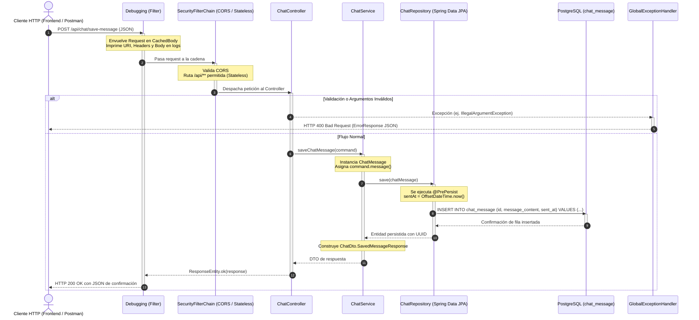

# Estudio Integral de Arquitectura Backend en Spring Boot

> **Objetivo de este documento**: Servir como guía pedagógica y laboratorio de estudio para aprender a analizar backends reales en **Java + Spring Boot**, utilizando este repositorio como caso de estudio práctico y extrapolando sus patrones a cualquier proyecto corporativo.

---

## 1. El Patrón Arquitectónico del Proyecto

### ¿Qué patrón utiliza este backend?
Este proyecto implementa una **Arquitectura en Capas (Layered Architecture o N-Tier)** tradicional, enriquecida con nociones tácticas de **DDD (Domain-Driven Design)** y **CQRS ligero (Command Query Responsibility Segregation)** en su estructura de paquetes (`api/command`, `api/dto`, `api/entity`, `api/service`, `api/controller`).

```text
[ Cliente HTTP ]
       │
       ▼
[ Filtros de Servlet (OncePerRequestFilter / Security) ]
       │
       ▼
[ Controller Layer (@RestController) ] ── (Comandos / DTOs)
       │
       ▼
[ Service Layer (@Service) ]
       │
       ▼
[ Data Access Layer (@Repository / Spring Data JPA) ]
       │
       ▼
[ Database (PostgreSQL) ]
```

### ¿Cómo reconocer este patrón en cualquier otro proyecto backend?
Cuando abras un repositorio Spring Boot desconocido, fíjate en:
1. **Separación vertical u horizontal**:
   * *Por capas (Layer-first)*: Carpetas `controllers/`, `services/`, `repositories/`, `models/` en la raíz.
   * *Por característica/módulo (Feature-first)*: Paquetes por dominio (como `api/` o `chat/`) y dentro las capas de ese dominio. Este proyecto combina ambos: tiene un paquete `core/` para lo transversal y `api/` para la funcionalidad del chat.
2. **Dirección unívoca de las dependencias**:
   El Controller conoce al Service; el Service conoce al Repository; el Repository conoce a la Entidad y la Base de Datos. **Nunca a la inversa**. Si un Repository llama a un Controller, la arquitectura está rota.
3. **Desacoplamiento de contratos externos e internos**:
   La presencia de `Command` o `DTO` evita exponer las `@Entity` de base de datos directamente al exterior.

---

## 2. Los Pilares de Spring en este Proyecto: IoC, DI, Beans y Ciclo de Vida

Para entender cualquier código en Spring Boot, es mandatorio comprender sus tres conceptos fundacionales:

### A. Inversión de Control (IoC - Inversion of Control)
En Java tradicional, si una clase `ChatController` necesita un `ChatService`, haría:
```java
// Acoplamiento fuerte (Tú controlas la instanciación)
this.chatService = new ChatService(new ChatRepositoryImpl());
```
En Spring Boot ocurre **Inversión de Control**: tú delegas el ciclo de vida, la creación y la configuración de los objetos al **Contenedor IoC de Spring** (`ApplicationContext`). Tú solo declaras qué necesitas; Spring decide cuándo y cómo instanciarlo.

### B. Inyección de Dependencias (DI - Dependency Injection)
Es el mecanismo técnico mediante el cual el contenedor IoC entrega a un objeto las dependencias que necesita para funcionar.
* **Inyección por Constructor (El estándar moderno de este proyecto)**:
  Observa [`ChatController.java`](file:///c:/Users/Casti/OneDrive/Documentos/9Semestre_UAA/Dev_Hackathon/ciberseguridad-primer-ejercicio/chat-spring-boot/src/main/java/com/eliascardona/chat_spring_boot/api/controller/ChatController.java#L18-L22):
  ```java
  private final ChatService chatService;

  public ChatController(ChatService chatService) {
      this.chatService = chatService;
  }
  ```
  > [!NOTE]
  > **¿Por qué no hay `@Autowired` aquí?**
  > Desde Spring 4.3, si una clase tiene un **único constructor**, Spring asume automáticamente que debe inyectar sus parámetros desde el contenedor IoC. Marcar el campo como `final` garantiza inmutabilidad y facilita pruebas unitarias sin levantar todo Spring.

### C. ¿Qué es un Bean de Spring?
Un **Bean** es simplemente un objeto Java común (POJO) que es instanciado, ensamblado, configurado y gestionado por el contenedor IoC de Spring.
* En este proyecto, `ChatController`, `ChatService`, `Debugging` y `SecurityConfig` son **Beans**.
* Las instancias de `ChatMessage` o `NewChatMessageCommand` **NO son Beans**; son objetos de datos efímeros que nacen y mueren en la petición o provienen de la base de datos.

### D. Ciclo de Vida de los Componentes
1. **Escaneo de Componentes (Component Scanning)**: Al arrancar `ChatSpringBootApplication`, Spring busca anotaciones `@Component`, `@Service`, `@RestController`, `@Configuration`.
2. **Definición de Beans**: Spring crea metadatos de qué beans existen y qué dependencias requieren entre sí.
3. **Instanciación y Resolución de Dependencias**: Spring detecta que `ChatController` necesita `ChatService`, y que `ChatService` necesita `ChatRepository`. Primero crea el repositorio, luego el servicio y finalmente el controlador.
4. **Post-procesamiento y Proxies**: Si hay seguridad, transacciones o auditoría, Spring envuelve el Bean en un *Proxy CGLIB/JDK*.
5. **Fase Operativa**: El bean atiende peticiones (por defecto son **Singletons**: una sola instancia viva para toda la aplicación).
6. **Destrucción**: Al apagar la aplicación (`context.close()`), se ejecutan métodos `@PreDestroy` y se cierran pools como HikariCP.

---

## 3. Análisis Capa por Capa del Backend

---

### Capa 1: Arranque de la Aplicación (Entry Point)

#### 1. ¿Qué responsabilidad tiene?
Iniciar el entorno de ejecución de Spring Boot, inicializar el `ApplicationContext`, disparar el auto-discovery de componentes y arrancar el servidor embebido (Tomcat).
#### 2. ¿Cómo se relaciona con las demás capas?
Es el nodo raíz. Escanea todos los subpaquetes bajo `com.eliascardona.chat_spring_boot` para registrar los Beans de las demás capas.
#### 3. Clases concretas del proyecto
* [`ChatSpringBootApplication.java`](file:///c:/Users/Casti/OneDrive/Documentos/9Semestre_UAA/Dev_Hackathon/ciberseguridad-primer-ejercicio/chat-spring-boot/src/main/java/com/eliascardona/chat_spring_boot/ChatSpringBootApplication.java)
#### 4. ¿Qué problema intenta resolver?
Evitar los complejos despliegues en servidores de aplicaciones externos (como JBoss, WebLogic o Tomcat externo) mediante un archivo JAR autocontenido y autoconfigurable.
#### 5. ¿Qué pasaría si no existiera?
El framework no sabría dónde comenzar el escaneo de componentes ni cómo inicializar los subsistemas de Spring.
#### 6. Conceptos de Spring a dominar
`SpringApplication.run()`, Servidor embebido Tomcat, classpath scanning.
#### 7. Específico vs General
* *General*: El método `main` y `@SpringBootApplication` es universal en el 100% de proyectos Spring Boot.
* *Específico*: El nombre del paquete base (`com.eliascardona.chat_spring_boot`).

---

### Capa 2: Configuración del Sistema (`core/springbootconfig/`)

#### 1. ¿Qué responsabilidad tiene?
Definir políticas de infraestructura: comportamiento transaccional, orígenes de escaneo de base de datos, políticas de CORS, auditoría y propiedades tipadas del sistema.
#### 2. ¿Cómo se relaciona con las demás capas?
Afecta transversalmente a todos los Beans. Por ejemplo, `JpaConfig` le dice a Spring Data dónde buscar repositorios y entidades; `SecurityConfig` decide qué rutas pueden ser alcanzadas por los Controllers.
#### 3. Clases concretas del proyecto
* [`JpaConfig.java`](file:///c:/Users/Casti/OneDrive/Documentos/9Semestre_UAA/Dev_Hackathon/ciberseguridad-primer-ejercicio/chat-spring-boot/src/main/java/com/eliascardona/chat_spring_boot/core/springbootconfig/JpaConfig.java): Configura el escaneo JPA, soporte transaccional y `@EnableJpaAuditing`.
* [`SecurityConfig.java`](file:///c:/Users/Casti/OneDrive/Documentos/9Semestre_UAA/Dev_Hackathon/ciberseguridad-primer-ejercicio/chat-spring-boot/src/main/java/com/eliascardona/chat_spring_boot/core/springbootconfig/SecurityConfig.java): Define el filtro de seguridad web, CORS y políticas de sesión.
* [`AppConfigurationProperties.java`](file:///c:/Users/Casti/OneDrive/Documentos/9Semestre_UAA/Dev_Hackathon/ciberseguridad-primer-ejercicio/chat-spring-boot/src/main/java/com/eliascardona/chat_spring_boot/core/springbootconfig/AppConfigurationProperties.java): Mapeo tipado de propiedades (JWT, OTP, RateLimit).
* [`application.yaml`](file:///c:/Users/Casti/OneDrive/Documentos/9Semestre_UAA/Dev_Hackathon/ciberseguridad-primer-ejercicio/chat-spring-boot/src/main/resources/application.yaml): Archivo declarativo de propiedades de datasource, hikari y dialectos.
#### 4. ¿Qué problema intenta resolver?
Centralizar y separar la configuración técnica del código de negocio, evitando *hardcoding* de URLs, credenciales o reglas de red.
#### 5. ¿Qué pasaría si no existiera?
Spring usaría valores por defecto que fallarían al conectarse a PostgreSQL, bloquearía peticiones del frontend por violaciones de CORS o no habilitaría la persistencia.
#### 6. Conceptos de Spring a dominar
`@Configuration`, `@Bean`, `@ConfigurationProperties`, Externalized Configuration (`application.yaml` + variables de entorno).
#### 7. Específico vs General
* *General*: Configurar `SecurityFilterChain` y `DataSource` en clases `@Configuration` es el estándar en Spring Boot 3+.
* *Específico*: Las reglas CORS específicas para `localhost:3000` y `localhost:5173`.

---

### Capa 3: Filtros e Interceptores Web (`Debugging.java`)

#### 1. ¿Qué responsabilidad tiene?
Interceptar las solicitudes HTTP antes de que toquen el Controller y después de que salgan, para realizar tareas de observabilidad, auditoría o diagnóstico.
#### 2. ¿Cómo se relaciona con las demás capas?
Se ubica en la frontera perimetral del servlet container. Envuelve la petición original en un wrapper especial y la pasa a la cadena de filtros (`FilterChain`).
#### 3. Clases concretas del proyecto
* [`Debugging.java`](file:///c:/Users/Casti/OneDrive/Documentos/9Semestre_UAA/Dev_Hackathon/ciberseguridad-primer-ejercicio/chat-spring-boot/src/main/java/com/eliascardona/chat_spring_boot/core/springbootconfig/Debugging.java)
#### 4. ¿Qué problema intenta resolver?
En el protocolo HTTP y la API de Servlets de Java, el `InputStream` de la petición solo se puede leer **una sola vez**. Si un filtro lee el cuerpo para imprimirlo en log, el Controller fallará porque el stream estará vacío. `Debugging` resuelve esto usando `CachedBodyHttpServletRequest` para almacenar en memoria los bytes y permitir lecturas múltiples.
#### 5. ¿Qué pasaría si no existiera?
No habría registro detallado en consola de los headers ni del payload JSON que envían los clientes HTTP, pero la aplicación funcionaría con normalidad.
#### 6. Conceptos de Spring a dominar
`OncePerRequestFilter`, Servlet Filters vs Spring HandlerInterceptors, `HttpServletRequestWrapper`.
#### 7. Específico vs General
* *General*: El uso de filtros para logging, trazas distribuidas (Correlation IDs) o autenticación de tokens.
* *Específico*: La implementación manual de `CachedBodyHttpServletRequest` (en entornos productivos se suele usar `ContentCachingRequestWrapper` de Spring).

---

### Capa 4: Seguridad (`SecurityConfig.java`)

#### 1. ¿Qué responsabilidad tiene?
Proteger los endpoints, definir esquemas de autenticación/autorización, gestionar sesiones y habilitar la comunicación entre distintos dominios (CORS).
#### 2. ¿Cómo se relaciona con las demás capas?
Actúa como un firewall previo a los Controllers. Si una petición no cumple las reglas, es rechazada con un código HTTP `401 Unauthorized` o `403 Forbidden` sin llegar a invocar el Controller.
#### 3. Clases concretas del proyecto
* [`SecurityConfig.java`](file:///c:/Users/Casti/OneDrive/Documentos/9Semestre_UAA/Dev_Hackathon/ciberseguridad-primer-ejercicio/chat-spring-boot/src/main/java/com/eliascardona/chat_spring_boot/core/springbootconfig/SecurityConfig.java)
#### 4. ¿Qué problema intenta resolver?
Evitar accesos no autorizados, proteger contra ataques CSRF en clientes web y permitir que navegadores en otros orígenes (puerto 3000 o 5173) consuman la API (CORS).
#### 5. ¿Qué pasaría si no existiera?
Por defecto, Spring Security bloquearía todas las peticiones requiriendo autenticación con contraseña generada en consola (`HTTP 401`), y el navegador bloquearía las peticiones del frontend por políticas CORS.
#### 6. Conceptos de Spring a dominar
`SecurityFilterChain`, `SessionCreationPolicy.STATELESS`, `CorsConfigurationSource`, `HttpSecurity` DSL.
#### 7. Específico vs General
* *General*: Uso de `SecurityFilterChain` como `@Bean` en Spring Security 6+.
* *Específico*: Tener `permitAll()` en `/api/**`, dejando el chat abierto sin requerir token por el momento.

---

### Capa 5: Manejo Global de Excepciones (`core/exceptions/`)

#### 1. ¿Qué responsabilidad tiene?
Capturar cualquier error no controlado ocurrido en cualquier capa (Controller, Service, Repository o Validación) y traducirlo a una respuesta HTTP uniforme y comprensible para el cliente.
#### 2. ¿Cómo se relaciona con las demás capas?
Utiliza el patrón *Aspect-Oriented Programming (AOP)*. Rodea la ejecución de los Controllers interceptando las excepciones lanzadas (ej. `EntityNotFoundException`).
#### 3. Clases concretas del proyecto
* [`GlobalExceptionHandler.java`](file:///c:/Users/Casti/OneDrive/Documentos/9Semestre_UAA/Dev_Hackathon/ciberseguridad-primer-ejercicio/chat-spring-boot/src/main/java/com/eliascardona/chat_spring_boot/core/exceptions/GlobalExceptionHandler.java)
#### 4. ¿Qué problema intenta resolver?
Evitar que la aplicación devuelva trazas de error Java con volcados de memoria (*stacktraces*) con código `500`, lo cual es un fallo grave de seguridad (fuga de información) y genera mala experiencia al cliente.
#### 5. ¿Qué pasaría si no existiera?
El cliente recibiría páginas de error HTML por defecto de Tomcat ("Whitelabel Error Page") o JSONs ambiguos e inconsistentes.
#### 6. Conceptos de Spring a dominar
`@ControllerAdvice` / `@RestControllerAdvice`, `@ExceptionHandler`, `MethodArgumentNotValidException`.
#### 7. Específico vs General
* *General*: El patrón `GlobalExceptionHandler` con un DTO estandarizado (`ErrorResponse`) es la convención universal de la industria en APIs RESTful.
* *Específico*: Los códigos de error personalizados (`ENTITY_NOT_FOUND`, `VALIDATION_ERROR`, `RATE_LIMIT_EXCEEDED`).

---

### Capa 6: Controladores REST / Presentación (`api/controller/`)

#### 1. ¿Qué responsabilidad tiene?
Ser la puerta de entrada de la API. Escucha peticiones HTTP, des-serializa JSON a objetos Java, ejecuta validaciones sintácticas, llama al Service correspondiente y empaqueta el resultado en un `ResponseEntity`.
#### 2. ¿Cómo se relaciona con las demás capas?
Recibe **Comandos/DTOs** desde el cliente HTTP, invoca a la **Capa de Servicio** pasándole esos datos, y devuelve **DTOs de respuesta**.
#### 3. Clases concretas del proyecto
* [`ChatController.java`](file:///c:/Users/Casti/OneDrive/Documentos/9Semestre_UAA/Dev_Hackathon/ciberseguridad-primer-ejercicio/chat-spring-boot/src/main/java/com/eliascardona/chat_spring_boot/api/controller/ChatController.java)
#### 4. ¿Qué problema intenta resolver?
Desacoplar el protocolo de transporte (HTTP, headers, status codes, JSON) de la lógica del negocio pura. El negocio no debe saber si la llamada vino de HTTP, gRPC o una cola RabbitMQ.
#### 5. ¿Qué pasaría si no existiera?
No habría manera de consumir el sistema a través de llamadas de red HTTP desde el navegador o clientes externos.
#### 6. Conceptos de Spring a dominar
`@RestController`, `@RequestMapping`, `@PostMapping`, `@GetMapping`, `@RequestBody`, `@RequestParam`, `ResponseEntity`.
#### 7. Específico vs General
* *General*: Estructura de endpoints REST con inyección de servicios.
* *Específico*: En este proyecto, el `ChatController` incluye bloques `try-catch` locales para `IllegalArgumentException` además de depender del `GlobalExceptionHandler`.

---

### Capa 7: Comandos y DTOs (`api/command/` y `api/dto/`)

#### 1. ¿Qué responsabilidad tiene?
Definir los **contratos de datos** (Data Transfer Objects). Indican exactamente qué datos se reciben del exterior y qué datos se retornan, sin exponer el modelo de datos interno.
#### 2. ¿Cómo se relaciona con las demás capas?
El cliente envía un `Command` al Controller; el Controller se lo pasa al Service; el Service responde con un `Dto` que el Controller envía al cliente.
#### 3. Clases concretas del proyecto
* [`NewChatMessageCommand.java`](file:///c:/Users/Casti/OneDrive/Documentos/9Semestre_UAA/Dev_Hackathon/ciberseguridad-primer-ejercicio/chat-spring-boot/src/main/java/com/eliascardona/chat_spring_boot/api/command/NewChatMessageCommand.java) (Record Java)
* [`ChatDto.java`](file:///c:/Users/Casti/OneDrive/Documentos/9Semestre_UAA/Dev_Hackathon/ciberseguridad-primer-ejercicio/chat-spring-boot/src/main/java/com/eliascardona/chat_spring_boot/api/dto/ChatDto.java) (`SavedMessageResponse`, `VerifiedMessageResponse`)
#### 4. ¿Qué problema intenta resolver?
Evita el anti-patrón de exponer entidades `@Entity` directas en los endpoints. Exponer entidades directamente provoca problemas de seguridad (sobreescritura masiva de campos), acoplamiento y problemas de serialización infinita en relaciones bidireccionales de JPA.
#### 5. ¿Qué pasaría si no existiera?
Tendríamos que enviar y recibir la clase `ChatMessage` directamente, exponiendo detalles internos de la base de datos a clientes externos.
#### 6. Conceptos de Spring / Java a dominar
Java Records (`record`), Serialización/Deserialización con Jackson, Lombok (`@Builder`, `@Data`).
#### 7. Específico vs General
* *General*: Uso de DTOs para aislar la API de la BD.
* *Específico*: Diferenciar `Command` (intención de mutación en CQRS) de `ResponseDto` (lectura).

---

### Capa 8: Mappers

#### 1. ¿Qué responsabilidad tiene?
Transformar datos entre representaciones distintas: de `Command/DTO` a `Entity`, y de `Entity` a `ResponseDTO`.
#### 2. ¿Cómo se relaciona con las demás capas?
Opera dentro de la capa de servicio o como componente utilitario intermedio.
#### 3. Clases concretas del proyecto
* **No hay una clase Mapper explícita en este proyecto**. El mapeo se realiza manualmente dentro de [`ChatService.java`](file:///c:/Users/Casti/OneDrive/Documentos/9Semestre_UAA/Dev_Hackathon/ciberseguridad-primer-ejercicio/chat-spring-boot/src/main/java/com/eliascardona/chat_spring_boot/api/service/ChatService.java#L25-L32):
  ```java
  ChatMessage chatMessage = new ChatMessage();
  chatMessage.setMessageContent(command.message());
  ...
  return ChatDto.SavedMessageResponse.builder()
          .chatMessageId(newChatMessage.getId())
          .messageContent(newChatMessage.getMessageContent())
          .build();
  ```
#### 4. ¿Qué problema intenta resolver?
Evitar copiar campo por campo de forma manual y propensa a errores cuando los objetos tienen decenas de propiedades.
#### 5. ¿Qué pasaría si no existiera?
Al ser un proyecto pequeño, el mapeo manual es suficiente y no afecta la funcionalidad.
#### 6. Conceptos de Spring a dominar
Bibliotecas de mapeo automático como **MapStruct** o **ModelMapper** (utilizadas ampliamente en proyectos corporativos más grandes).
#### 7. Específico vs General
* *General*: La necesidad de transformar objetos de transporte en objetos de persistencia.
* *Específico*: Mapeo imperativo manual dentro de los métodos del servicio en lugar de usar interfaces mapper dedicadas.

---

### Capa 9: Validaciones

#### 1. ¿Qué responsabilidad tiene?
Garantizar que los datos entrantes cumplan con reglas de integridad sintáctica y semántica antes de ser procesados por el negocio.
#### 2. ¿Cómo se relaciona con las demás capas?
Se dispara en el Controller (`@Validated`, `@RequestBody`) y, si falla, salta directamente al `GlobalExceptionHandler` interceptando `MethodArgumentNotValidException`.
#### 3. Clases concretas del proyecto
* Anotaciones `@Validated` en [`ChatController.java`](file:///c:/Users/Casti/OneDrive/Documentos/9Semestre_UAA/Dev_Hackathon/ciberseguridad-primer-ejercicio/chat-spring-boot/src/main/java/com/eliascardona/chat_spring_boot/api/controller/ChatController.java#L26).
#### 4. ¿Qué problema intenta resolver?
Impedir que datos nulos, cadenas vacías o tipos incompatibles ingresen a la capa de negocio o a la base de datos, corrompiendo la consistencia del sistema.
#### 5. ¿Qué pasaría si no existiera?
Tendríamos que escribir decenas de `if (mensaje == null || mensaje.isEmpty())` manualmente al inicio de cada método.
#### 6. Conceptos de Spring a dominar
Jakarta Bean Validation (`@NotNull`, `@NotBlank`, `@Size`, `@Pattern`), anotación `@Valid` vs `@Validated`.
#### 7. Específico vs General
* *General*: Uso de Bean Validation en la frontera de entrada del controlador.
* *Específico*: En este proyecto el Command `NewChatMessageCommand` no cuenta con anotaciones como `@NotBlank` en sus campos, apoyándose solo en la validación a nivel base de datos (`nullable = false` en la entidad).

---

### Capa 10: Capa de Servicio / Negocio (`api/service/`)

#### 1. ¿Qué responsabilidad tiene?
Albergar las reglas de negocio de la aplicación, orquestar flujos de trabajo, coordinar múltiples repositorios y gestionar límites transaccionales (`@Transactional`).
#### 2. ¿Cómo se relaciona con las demás capas?
Es el cerebro del backend. Es consumido por el Controller y consume a los Repositories.
#### 3. Clases concretas del proyecto
* [`ChatService.java`](file:///c:/Users/Casti/OneDrive/Documentos/9Semestre_UAA/Dev_Hackathon/ciberseguridad-primer-ejercicio/chat-spring-boot/src/main/java/com/eliascardona/chat_spring_boot/api/service/ChatService.java)
#### 4. ¿Qué problema intenta resolver?
Evitar el anti-patrón de poner lógica en los Controllers ("Smart Controllers") o en los Repositorios ("Smart Repositories"). Centraliza el "qué hace el sistema".
#### 5. ¿Qué pasaría si no existiera?
Toda la lógica de guardado y mapeo estaría duplicada o amontonada en el Controller, impidiendo reutilizarla si se agrega otro canal (ej. WebSockets o colas Kafka).
#### 6. Conceptos de Spring a dominar
`@Service`, `@Transactional`, manejo de excepciones de negocio (`EntityNotFoundException`).
#### 7. Específico vs General
* *General*: Servicios como componentes `@Service` inyectados en controladores.
* *Específico*: Lógica sencilla (CRUD directo) con dos métodos principales: `saveChatMessage` y `findChatMessageById`.

---

### Capa 11: Capa de Persistencia / Repositorios (`api/repository/`)

#### 1. ¿Qué responsabilidad tiene?
Abstraer el acceso a la base de datos relacional. Ofrece operaciones CRUD, paginación, ordenamiento y ejecución de consultas SQL/JPQL sin requerir código SQL manual.
#### 2. ¿Cómo se relaciona con las demás capas?
Es invocado por el Service y devuelve o persiste instancias de `@Entity`.
#### 3. Clases concretas del proyecto
* [`ChatRepository.java`](file:///c:/Users/Casti/OneDrive/Documentos/9Semestre_UAA/Dev_Hackathon/ciberseguridad-primer-ejercicio/chat-spring-boot/src/main/java/com/eliascardona/chat_spring_boot/api/repository/ChatRepository.java)
#### 4. ¿Qué problema intenta resolver?
Eliminar miles de líneas de código JDBC tradicional (`Connection`, `PreparedStatement`, `ResultSet`, mapeo manual fila por fila).
#### 5. ¿Qué pasaría si no existiera?
Tendríamos que escribir sentencias SQL manuales y gestionar conexiones a bajo nivel para guardar o buscar cada mensaje.
#### 6. Conceptos de Spring a dominar
Spring Data JPA, interfaces dinámicas generadas en runtime, `JpaRepository<T, ID>`, `JpaSpecificationExecutor<T>`.
#### 7. Específico vs General
* *General*: Declarar una interfaz que herede de `JpaRepository` sin escribir una sola línea de implementación.
* *Específico*: Uso de `UUID` como clave primaria en lugar de `Long`.

---

### Capa 12: Entidades / Modelo de Persistencia (`api/entity/`)

#### 1. ¿Qué responsabilidad tiene?
Representar la estructura de datos relacional como una clase de Java (Mapeo Objeto-Relacional con Hibernate). Cada instancia equivale a una fila en la tabla de la base de datos.
#### 2. ¿Cómo se relaciona con las demás capas?
Es manipulada por los Repositories y los Services.
#### 3. Clases concretas del proyecto
* [`ChatMessage.java`](file:///c:/Users/Casti/OneDrive/Documentos/9Semestre_UAA/Dev_Hackathon/ciberseguridad-primer-ejercicio/chat-spring-boot/src/main/java/com/eliascardona/chat_spring_boot/api/entity/ChatMessage.java)
#### 4. ¿Qué problema intenta resolver?
Permite al desarrollador pensar en términos de objetos orientados a objetos (con métodos, tipos y relaciones) en lugar de pensar en tablas relacionales y tipos de columnas SQL.
#### 5. ¿Qué pasaría si no existiera?
El ORM (Hibernate) no sabría cómo mapear los datos que vienen del driver PostgreSQL ni cómo generar el esquema DDL.
#### 6. Conceptos de Spring / JPA a dominar
`@Entity`, `@Table`, `@Id`, `@GeneratedValue`, `@Column`, ciclo de vida JPA (`@PrePersist`).
#### 7. Específico vs General
* *General*: Modelado con JPA estándar.
* *Específico*: Uso del hook `@PrePersist` para asignar `sentAt = OffsetDateTime.now()` antes de enviar el INSERT a la base de datos.

---

### Capa 13: Utilidades y Clases de Soporte

#### 1. ¿Qué responsabilidad tiene?
Proveer funcionalidades reutilizables o wrappers técnicos auxiliares.
#### 2. ¿Cómo se relaciona con las demás capas?
Asiste a capas técnicas como filtros o controladores.
#### 3. Clases concretas del proyecto
* `CachedBodyHttpServletRequest` y `CachedBodyServletInputStream` (declaradas como clases estáticas internas dentro de [`Debugging.java`](file:///c:/Users/Casti/OneDrive/Documentos/9Semestre_UAA/Dev_Hackathon/ciberseguridad-primer-ejercicio/chat-spring-boot/src/main/java/com/eliascardona/chat_spring_boot/core/springbootconfig/Debugging.java#L55-L102)).
#### 4. ¿Qué problema intenta resolver?
Extender la infraestructura de Servlets de Java para hacerla compatible con los requerimientos de inspección del filtro de depuración.

---

## 4. Desglose Exhaustivo de Anotaciones de Spring

A continuación, se detalla qué hace cada anotación en este proyecto, qué ocurre internamente en Spring y cómo identificarla en cualquier proyecto.

---

### `@SpringBootApplication`
* **En este proyecto**: Marca la clase [`ChatSpringBootApplication`](file:///c:/Users/Casti/OneDrive/Documentos/9Semestre_UAA/Dev_Hackathon/ciberseguridad-primer-ejercicio/chat-spring-boot/src/main/java/com/eliascardona/chat_spring_boot/ChatSpringBootApplication.java#L6) como punto de partida de la aplicación.
* **Mecanismo interno**: Es una meta-anotación que combina tres anotaciones esenciales:
  1. `@Configuration`: Convierte a la clase en fuente de definiciones de beans.
  2. `@EnableAutoConfiguration`: Lee el classpath y autoconfigura Tomcat, Hikari, Jackson, etc., según las dependencias presentes en `pom.xml`.
  3. `@ComponentScan`: Le dice a Spring que busque componentes recursivamente a partir del paquete actual (`com.eliascardona.chat_spring_boot`).
* **Por qué se utiliza**: Elimina la necesidad de configuraciones XML complejas de versiones anteriores de Spring.
* **Problema que resuelve**: Automatiza el arranque (*bootstrapping*) de toda la infraestructura con una sola línea.
* **Cómo reconocerlo en otro proyecto**: Siempre está presente en la clase que contiene el método `main`.

---

### `@RestController`
* **En este proyecto**: Decora la clase [`ChatController`](file:///c:/Users/Casti/OneDrive/Documentos/9Semestre_UAA/Dev_Hackathon/ciberseguridad-primer-ejercicio/chat-spring-boot/src/main/java/com/eliascardona/chat_spring_boot/api/controller/ChatController.java#L12).
* **Mecanismo interno**: Combina `@Controller` y `@ResponseBody`. Hace que Spring registre la clase en el `HandlerMapping` de Spring MVC. Cuando un método retorna un objeto (ej. `ResponseEntity<ChatDto>`), Spring no busca una vista HTML (como Thymeleaf o JSP), sino que activa automáticamente `HttpMessageConverter` (usando la biblioteca Jackson) para serializar el objeto a formato JSON en el cuerpo HTTP.
* **Por qué se utiliza**: Es la base para crear APIs RESTful en Spring Boot.
* **Problema que resuelve**: Ahorra colocar `@ResponseBody` en cada método del controlador.
* **Cómo reconocerlo en otro proyecto**: Identifica las clases que gestionan las URLs de la API pública.

---

### `@Service`
* **En este proyecto**: Marca a [`ChatService`](file:///c:/Users/Casti/OneDrive/Documentos/9Semestre_UAA/Dev_Hackathon/ciberseguridad-primer-ejercicio/chat-spring-boot/src/main/java/com/eliascardona/chat_spring_boot/api/service/ChatService.java#L12) como un Bean de servicio.
* **Mecanismo interno**: Es una especialización de `@Component`. Técnicamente es idéntica a `@Component` en cuanto a registro de Bean en el IoC container, pero comunica semánticamente que la clase encapsula lógica de negocio y permite aplicar aspectos AOP (como telemetría o `@Transactional`).
* **Por qué se utiliza**: Para delimitar la capa de negocio dentro de la arquitectura.
* **Problema que resuelve**: Permite desacoplar las operaciones de negocio para ser inyectadas donde se requieran.
* **Cómo reconocerlo en otro proyecto**: Todas las clases que coordinan casos de uso suelen terminar en `Service` o `ServiceImpl` y llevan esta anotación.

---

### `@Repository`
* **En este proyecto**: *Observación didáctica*: [`ChatRepository`](file:///c:/Users/Casti/OneDrive/Documentos/9Semestre_UAA/Dev_Hackathon/ciberseguridad-primer-ejercicio/chat-spring-boot/src/main/java/com/eliascardona/chat_spring_boot/api/repository/ChatRepository.java#L10) **no tiene** la anotación `@Repository` escrita.
* **¿Por qué funciona sin ella?**: Al heredar de `JpaRepository`, el mecanismo de Spring Data detecta la interfaz automáticamente gracias a `@EnableJpaRepositories` (declarado en `JpaConfig`). Spring crea en tiempo de ejecución una clase proxy (un Bean) que implementa todos los métodos.
* **Mecanismo interno de `@Repository`**: Además de registrar un Bean, activa la traducción automática de excepciones de persistencia (como excepciones SQL específicas del driver) a la jerarquía genérica de Spring (`DataAccessException`).
* **Cómo reconocerlo en otro proyecto**: Verás `@Repository` en implementaciones DAO tradicionales o repositorios personalizados con SQL nativo.

---

### `@Component`
* **En este proyecto**: Decora la clase [`Debugging`](file:///c:/Users/Casti/OneDrive/Documentos/9Semestre_UAA/Dev_Hackathon/ciberseguridad-primer-ejercicio/chat-spring-boot/src/main/java/com/eliascardona/chat_spring_boot/core/springbootconfig/Debugging.java#L23).
* **Mecanismo interno**: Es la anotación raíz para cualquier objeto que debe ser administrado por el contenedor IoC. Cuando Spring realiza el escaneo de componentes, cualquier clase con `@Component` (o con anotaciones derivadas como `@Service`, `@Controller`, `@Repository`, `@Configuration`) es instanciada como un Bean Singleton.
* **Por qué se utiliza**: Para componentes que no encajan claramente en las etiquetas semánticas de controlador, servicio o repositorio (como filtros, interceptores o procesadores de tareas).
* **Problema que resuelve**: Integra clases de infraestructura personalizadas al ciclo de vida de Spring.

---

### `@Configuration` y `@Bean`
* **En este proyecto**: Utilizadas en [`SecurityConfig`](file:///c:/Users/Casti/OneDrive/Documentos/9Semestre_UAA/Dev_Hackathon/ciberseguridad-primer-ejercicio/chat-spring-boot/src/main/java/com/eliascardona/chat_spring_boot/core/springbootconfig/SecurityConfig.java#L18) y [`JpaConfig`](file:///c:/Users/Casti/OneDrive/Documentos/9Semestre_UAA/Dev_Hackathon/ciberseguridad-primer-ejercicio/chat-spring-boot/src/main/java/com/eliascardona/chat_spring_boot/core/springbootconfig/JpaConfig.java#L9).
* **Mecanismo interno**:
  * `@Configuration` indica que la clase contiene métodos fábrica de beans. Spring envuelve estas clases con un proxy CGLIB para asegurar que las llamadas entre métodos `@Bean` mantengan el patrón Singleton.
  * `@Bean` se coloca sobre un **método**. El objeto retornado por ese método es registrado en el contenedor IoC de Spring.
* **Por qué se utiliza**: Permite registrar beans de clases de librerías externas o frameworks (como `SecurityFilterChain`) cuyo código fuente no podemos modificar para agregarles un `@Component`.
* **Problema que resuelve**: Permite la instanciación programática y configuración avanzada de objetos complejos.
* **Cómo reconocerlo en otro proyecto**: Todo archivo con nombre `*Config.java` suele tener `@Configuration` y métodos con `@Bean`.

---

### `@ConfigurationProperties`
* **En este proyecto**: En [`AppConfigurationProperties`](file:///c:/Users/Casti/OneDrive/Documentos/9Semestre_UAA/Dev_Hackathon/ciberseguridad-primer-ejercicio/chat-spring-boot/src/main/java/com/eliascardona/chat_spring_boot/core/springbootconfig/AppConfigurationProperties.java#L11).
* **Mecanismo interno**: Lee un prefijo en el archivo `application.yaml` (ej. `core.springbootconfig`) y mapea automáticamente sus subclaves a los campos de la clase Java en base a nombres de getters/setters.
* **Por qué se utiliza**: Provee seguridad de tipos (*Type-Safe Configuration*) para configuraciones complejas, superando las limitaciones de poner decenas de `@Value("${mi.propiedad}")` sueltos.
* **Problema que resuelve**: Validación y centralización de parámetros de entorno estructurados.

---

### `@ControllerAdvice` / `@ExceptionHandler`
* **En este proyecto**: En [`GlobalExceptionHandler`](file:///c:/Users/Casti/OneDrive/Documentos/9Semestre_UAA/Dev_Hackathon/ciberseguridad-primer-ejercicio/chat-spring-boot/src/main/java/com/eliascardona/chat_spring_boot/core/exceptions/GlobalExceptionHandler.java#L20).
* **Mecanismo interno**: Interceptor AOP global. Cuando un Controller lanza una excepción que no es capturada localmente, el `DispatcherServlet` delega el control a las clases con `@ControllerAdvice`, buscando un método decorado con `@ExceptionHandler(TipoDeExcepcion.class)`.
* **Por qué se utiliza**: Para evitar bloques `try-catch` redundantes en todos los métodos de los controladores.
* **Problema que resuelve**: Normaliza la respuesta ante errores en un único punto del sistema.

---

### `@Entity`, `@Table`, `@Id`, `@GeneratedValue`
* **En este proyecto**: En [`ChatMessage.java`](file:///c:/Users/Casti/OneDrive/Documentos/9Semestre_UAA/Dev_Hackathon/ciberseguridad-primer-ejercicio/chat-spring-boot/src/main/java/com/eliascardona/chat_spring_boot/api/entity/ChatMessage.java#L13-L17).
* **Mecanismo interno**: Pertenecen a la especificación estándar **Jakarta Persistence (JPA)**, no a Spring directamente. Hibernate lee estas anotaciones en el arranque para crear el metamodelo de la base de datos:
  * `@Entity`: Marca la clase como un registro gestionado en la sesión de Hibernate.
  * `@Table(name = "chat_message")`: Define el nombre real de la tabla en PostgreSQL.
  * `@Id`: Declara la clave primaria.
  * `@GeneratedValue(strategy = GenerationType.UUID)`: Delega la generación del identificador UUID único a Hibernate/BD.

---

## 5. Diagrama de Arquitectura del Código Real

A continuación se muestra el flujo exacto de ejecución de una petición de guardado de mensaje (`POST /api/chat/save-message`):



---

## 6. Lo que Debo Aprender de Spring para Poder Entender este Backend

Para maximizar la eficiencia de tu estudio, aborda los conceptos en este orden:

### 1. Nivel Fundamental (Imprescindible para no perderse)
Si dominas esto, podrás leer y comprender el 80% del flujo diario de este backend y de cualquier proyecto Spring Boot:
* **Inyección de Dependencias por Constructor**: Entender por qué no hace falta `@Autowired` y cómo Spring enlaza Controller -> Service -> Repository.
* **Anotaciones estereotipo básicas**: Diferencia clara entre `@RestController`, `@Service`, `@Repository` y `@Component`.
* **Spring MVC Básico**: Cómo mapear endpoints con `@GetMapping`, `@PostMapping`, cómo recibir datos con `@RequestBody` y parámetros con `@RequestParam`.
* **Spring Data JPA Básico**: Comprender qué significa que una interfaz herede de `JpaRepository<Entidad, ID>` y qué métodos vienen incluidos gratis (`save`, `findById`, `findAll`, `deleteById`).
* **Entidades JPA**: Uso de `@Entity`, `@Table`, `@Id`, `@Column`.
* **Configuración básica**: Cómo `application.yaml` o `application.properties` se conecta con variables de entorno para configurar el puerto y la base de datos.

### 2. Nivel Intermedio (Para entender por qué las cosas funcionan o se rompen)
Estos conceptos explican la robustez, el manejo de errores y la configuración de este sistema:
* **Manejo global de excepciones**: Cómo opera `@ControllerAdvice` y `@ExceptionHandler` para atrapar errores y devolver JSON consistente.
* **Filtros de Servlets**: Ciclo de vida de `OncePerRequestFilter` y por qué los streams HTTP se leen una sola vez.
* **Configuración con `@Configuration` y `@Bean`**: Cuándo y por qué se usan métodos que devuelven Beans (como `SecurityFilterChain`).
* **Spring Security Básico**: Entender la diferencia entre autenticación (quién eres) y autorización (qué puedes hacer), y qué es una política `SessionCreationPolicy.STATELESS`.
* **CORS**: Entender qué es una petición pre-flight (`OPTIONS`), qué encabezados exige el navegador y por qué se configura `CorsConfigurationSource`.
* **Ciclo de vida JPA**: Anotaciones como `@PrePersist` para inicializar campos antes del INSERT.

### 3. Nivel Avanzado / Todavía no necesario para este código
En este repositorio existen dependencias o clases preparadas pero no explotadas a fondo todavía. Puedes posponer estos temas para una etapa posterior:
* **OAuth2 Authorization Server y JJWT**: Aunque están en el `pom.xml` y en `AppConfigurationProperties`, los endpoints actuales del chat están abiertos (`permitAll()`). No necesitas aprender criptografía JWT ni flujo OAuth2 todavía para entender la lógica del chat.
* **Apache Kafka (`spring-kafka`)**: Declarado en `pom.xml`, pero no hay productores ni consumidores activos en el código actual.
* **`JpaSpecificationExecutor`**: Está en la interfaz `ChatRepository`, pero no se está usando todavía para búsquedas dinámicas avanzadas con Specifications.
* **Spring AOP en profundidad**: Creación de aspectos personalizados con `@Aspect` y Pointcuts.
