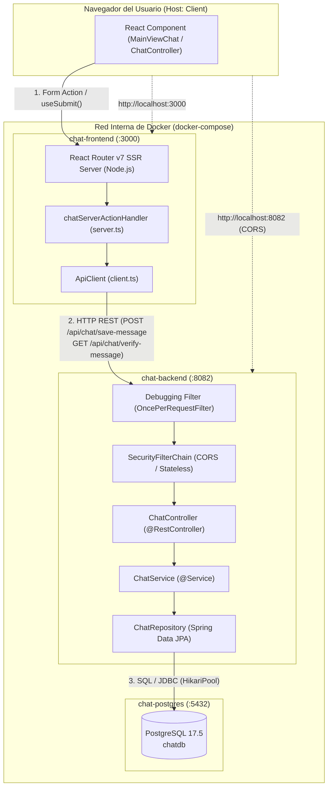

# Mapa de Arquitectura y Reconocimiento Estructural del Sistema

> **Propósito del documento**: Servir como contexto permanente para el análisis, laboratorio de aprendizaje y entendimiento arquitectónico de este proyecto y futuros proyectos backend.

---

## 1. Resumen Ejecutivo del Proyecto

* **Dominio**: Aplicación de mensajería (chat) con persistencia relacional, arquitectura de microservicios contenerizados y soporte para autenticación/auditoría.
* **Componentes Principales**:
  * **Backend**: API REST desarrollada en Java 17 con Spring Boot 3.5.16 y Spring Data JPA.
  * **Frontend**: Aplicación interactiva con Server-Side Rendering (SSR) y patrón BFF en React 19 y React Router v7.
  * **Base de Datos**: PostgreSQL 17.5 gestionada con HikariCP y Hibernate DDL Auto.
  * **Infraestructura**: Orquestación declarativa mediante Docker Compose con redes internas y healthchecks.

---

## 2. Árbol Estructural y Responsabilidades

```text
ciberseguridad-primer-ejercicio/
├── .env                          # Variables de entorno globales del despliegue
├── docker-compose.yaml           # Orquestación de contenedores (Postgres, Backend, Frontend)
├── README.md                     # Documentación de arranque rápido (con y sin Docker)
├── script-sin-docker.ps1         # Script PowerShell de aprovisionamiento en Windows
│
├── chat-spring-boot/             # [BACKEND: Servicio API REST en Spring Boot]
│   ├── Dockerfile                # Multi-stage build (Maven 3.9 + Eclipse Temurin 17 JRE)
│   ├── pom.xml                   # Descriptor de dependencias y plugins Maven
│   ├── mvnw / mvnw.cmd           # Maven Wrapper para compilación sin Maven local
│   └── src/
│       ├── main/
│       │   ├── java/com/eliascardona/chat_spring_boot/
│       │   │   ├── ChatSpringBootApplication.java # Entry point de la aplicación (@SpringBootApplication)
│       │   │   ├── api/          # Capa de dominio y funcionalidad del chat
│       │   │   │   ├── command/     # Records con comandos de entrada (CQRS ligero)
│       │   │   │   │   └── NewChatMessageCommand.java
│       │   │   │   ├── controller/  # Controladores REST
│       │   │   │   │   └── ChatController.java
│       │   │   │   ├── dto/         # Objetos de transferencia de respuesta
│       │   │   │   │   └── ChatDto.java
│       │   │   │   ├── entity/      # Entidades persistentes JPA
│       │   │   │   │   └── ChatMessage.java
│       │   │   │   ├── repository/  # Interfaces Spring Data JPA
│       │   │   │   │   └── ChatRepository.java
│       │   │   │   └── service/     # Lógica de negocio y persistencia
│       │   │   │       └── ChatService.java
│       │   │   └── core/         # Componentes transversales y de infraestructura
│       │   │       ├── exceptions/      # Manejo global de excepciones (@ControllerAdvice)
│       │   │       │   └── GlobalExceptionHandler.java
│       │   │       └── springbootconfig/# Clases de configuración Spring
│       │   │           ├── AppConfigurationProperties.java # Propiedades tipadas de la app
│       │   │           ├── Debugging.java                 # Filtro HTTP para logging de request/body
│       │   │           ├── JpaConfig.java                 # Habilitación de auditoría y repositorios JPA
│       │   │           └── SecurityConfig.java            # Configuración de Spring Security y CORS
│       │   └── resources/
│       │       └── application.yaml # Configuración principal de Spring Boot
│       └── test/                 # Pruebas automatizadas (JUnit 5)
│           └── java/com/eliascardona/opselling_operative_plane/
│               └── OpsellingOperativePlaneApplicationTests.java
│
└── chat-frontend/                # [FRONTEND: Aplicación React Router v7 con SSR]
    ├── Dockerfile                # Multi-stage build en node:22-alpine
    ├── package.json              # Dependencias y scripts npm
    ├── package-lock.json         # Lockfile de dependencias npm
    ├── vite.config.ts            # Bundler Vite + plugins
    ├── react-router.config.ts    # Configuración de React Router (ssr: true)
    ├── tsconfig.json             # Configuración del compilador TypeScript
    ├── app/                      # Código fuente de la aplicación frontend
    │   ├── root.tsx              # Shell HTML raíz de la aplicación
    │   ├── routes.ts             # Enrutamiento basado en archivos (flatRoutes)
    │   ├── routes/               # Rutas principales (_index.tsx, chat.tsx, 403.tsx, 404.tsx)
    │   ├── components/           # Componentes UI (chat, layouts, formularios y primitivas shadcn/ui)
    │   ├── lib/                  # Cliente HTTP, tipado de comandos, esquemas Zod y acciones
    │   │   ├── chat/             # Lógica específica del módulo de chat (api, server actions, state machine)
    │   │   ├── infrastructure/   # Cliente HTTP fetch parametrizado para Browser y Node
    │   │   └── shared/           # Tipos y esquemas reutilizables
    │   └── hooks/                # Hooks personalizados de React
    └── public/                   # Recursos estáticos
```

---

## 3. Mapa de Tecnologías y Versiones Exactas

Todas las versiones corresponden a los archivos de configuración del repositorio:

| Capa / Herramienta | Nombre | Versión Exacta | Archivo de Origen |
| :--- | :--- | :--- | :--- |
| **Java Platform** | OpenJDK (Eclipse Temurin / Amazon Corretto) | **17** | `pom.xml`, `Dockerfile`, `script-sin-docker.ps1` |
| **Backend Framework** | Spring Boot (`spring-boot-starter-parent`) | **3.5.16** | `chat-spring-boot/pom.xml` |
| **Seguridad Backend** | Spring Security OAuth2 Authorization Server | **1.5.3** | `chat-spring-boot/pom.xml` |
| **JWT** | JJWT (`jjwt-api`, `jjwt-impl`, `jjwt-jackson`) | **0.12.6** | `chat-spring-boot/pom.xml` |
| **Persistencia ORM** | Spring Data JPA / Hibernate | Gestionada por Spring Boot | `chat-spring-boot/pom.xml` |
| **Pool Conexiones** | HikariCP (`HikariPoolSpringBootChat`) | Gestionada por Spring Boot | `application.yaml` |
| **Mensajería** *(declarada)* | Spring Kafka (`spring-kafka`) | Gestionada por Spring Boot | `chat-spring-boot/pom.xml` |
| **Productividad Java** | Project Lombok | `provided` | `chat-spring-boot/pom.xml` |
| **Base de Datos** | PostgreSQL Container | **17.5** | `docker-compose.yaml`, `.env` |
| **Driver BD** | PostgreSQL JDBC Driver (`org.postgresql:postgresql`) | Gestionada por Spring Boot | `chat-spring-boot/pom.xml` |
| **Frontend Framework** | React / React DOM | **^19.1.1** | `chat-frontend/package.json` |
| **Enrutador / SSR** | React Router v7 (`@react-router/dev: ^7.11.0`) | **^7.9.1** | `chat-frontend/package.json` |
| **Bundler Frontend** | Vite | **^7.1.3** | `chat-frontend/package.json` |
| **Lenguaje Frontend** | TypeScript | **^5.9.2** | `chat-frontend/package.json` |
| **Estilos CSS** | Tailwind CSS | **^4.1.12** | `chat-frontend/package.json` |
| **Validación Esquemas** | Zod | **^3.25.76** | `chat-frontend/package.json` |
| **Frontend Runtime** | Node.js Alpine | **22-alpine** | `chat-frontend/Dockerfile` |
| **Build Backend** | Apache Maven | **3.9** (Docker) / Wrapper | `chat-spring-boot/Dockerfile`, `mvnw` |
| **Scripting Windows** | PowerShell | **5.1** (`#Requires -Version 5.1`) | `script-sin-docker.ps1` |

---

## 4. Puntos de Entrada (*Entry Points*)

* **Backend**:
  * Clase principal: `ChatSpringBootApplication.java` -> `public static void main(String[] args)`.
  * Runtime de contenedor: `ENTRYPOINT ["java", "-jar", "app.jar"]` en `chat-spring-boot/Dockerfile`.
* **Frontend**:
  * Producción / Contenedor: `CMD ["npm", "run", "start"]` -> `react-router-serve ./build/server/index.js` (puerto 3000).
  * Desarrollo local: `npm run dev` -> `react-router dev` (Vite en puerto 5173).
  * Punto de montaje DOM: `chat-frontend/app/root.tsx` y enrutamiento en `chat-frontend/app/routes.ts`.
* **PostgreSQL**:
  * Contenedor `chat-postgres` en `docker-compose.yaml` (puerto 5432 interno).
  * Sin Docker: Proceso manual mediante cliente CLI `psql -U postgres -p <PUERTO>` según `README.md`.
* **Docker / Infraestructura**:
  * `docker-compose.yaml` en la raíz del repositorio.
* **Scripts**:
  * `script-sin-docker.ps1`: Automatización para instalar Scoop, Java Corretto 17, Maven 3 y configurar `JAVA_HOME`.
  * `mvnw` y `mvnw.cmd`: Wrapper portable para ejecutar tareas Maven sin instalación previa.

---

## 5. Matriz de Configuración

| Parámetro / Componente | Archivo de Origen | Descripción / Valor |
| :--- | :--- | :--- |
| **Puerto Backend** | `.env`, `application.yaml`, `docker-compose.yaml` | `8082` (variable `BACKEND_PORT`). |
| **Puerto Frontend** | `docker-compose.yaml`, `chat-frontend/Dockerfile` | `3000` en producción/Docker; `5173` en desarrollo local Vite. |
| **Puerto PostgreSQL** | `docker-compose.yaml` | `5432` (solo accesible en la red interna de Docker). |
| **Conexión JDBC** | `.env`, `docker-compose.yaml`, `application.yaml` | `jdbc:postgresql://postgres:5432/${POSTGRES_DB}` con driver `org.postgresql.Driver`. |
| **Estrategia DDL** | `.env` (`HIBERNATE_DDL_AUTO`), `application.yaml` | `update` (Hibernate crea y actualiza tablas en arranque). |
| **Pool de Conexiones** | `chat-spring-boot/.../application.yaml` | HikariCP (`maximum-pool-size: 20`, pool `HikariPoolSpringBootChat`). |
| **CORS** | `SecurityConfig.java` | Permite orígenes `http://localhost:5173` y `http://localhost:3000` con métodos `GET`, `POST`, `OPTIONS`. |
| **Autorización REST** | `SecurityConfig.java` | Libre acceso sin autenticación a todas las rutas `/api/**` (`permitAll()`). |
| **Perfiles de Spring** | *No declarados* | Se opera con el perfil por defecto; parametrización 100% mediante variables de entorno. |
| **URLs API en Frontend** | `.env`, `client.ts` | Navegador usa `VITE_API_URL` (`http://localhost:8082/api/`). Servidor SSR usa `SERVER_API_URL` (`http://backend:8082/api/`). |

---

## 6. Arquitectura del Sistema (Flujo Real)



### Endpoints REST Expuestos
1. `POST /api/chat/save-message`
   * **Entrada**: Payload JSON con estructura `NewChatMessageCommand` (`message`, `sender`, `recipient`).
   * **Salida**: `ChatDto.SavedMessageResponse` (`chatMessageId`, `messageContent`).
2. `GET /api/chat/verify-message?chatMessageId={uuid}`
   * **Entrada**: Parámetro query con el identificador UUID del mensaje.
   * **Salida**: `ChatDto.VerifiedMessageResponse` (`chatMessageId`, `messageContent`).

---

## 7. Conceptos Clave para el Estudio

* **Java & Spring Boot**:
  * Inyección de dependencias mediante constructor.
  * Records de Java 17 como DTOs inmutables.
  * Clases `@Configuration`, `@ConfigurationProperties` y beans de infraestructura.
* **Spring MVC & REST**:
  * `@RestController`, `@PostMapping`, `@GetMapping`, `@Validated`.
  * Filtros de servlets (`OncePerRequestFilter`) e interceptación de Streams con `HttpServletRequestWrapper`.
  * Manejo centralizado de excepciones mediante `@ControllerAdvice` y `@ExceptionHandler`.
* **JPA & Base de Datos**:
  * Mapeo de entidades (`@Entity`, `@Table`, `@Id`, `@GeneratedValue`).
  * Hooks de ciclo de vida (`@PrePersist`).
  * Spring Data JPA (`JpaRepository`).
  * Gestión de conexiones mediante HikariCP.
* **Docker & DevOps**:
  * Multi-stage builds para optimización de tamaño y seguridad de imágenes.
  * Resolución de nombres por DNS interno de Docker Compose (`postgres`, `backend`).
  * Chequeos de salud (`healthcheck` con `pg_isready`) y orden de arranque con `condition: service_healthy`.
  * Volúmenes con persistencia (`postgres_data`).
* **Frontend Moderno**:
  * Server-Side Rendering (SSR) y BFF con React Router v7.
  * Validación dual y contratos tipados mediante Zod.
  * Máquinas de estado en React para sincronización UI/servidor.

---

## 8. Ruta Metódica de Lectura de Código

Para realizar un análisis limpio y sin saturación cognitiva:

1. **Infraestructura**: `.env` -> `docker-compose.yaml` -> `chat-spring-boot/Dockerfile`.
2. **Configuración Backend**: `pom.xml` -> `application.yaml` -> `SecurityConfig.java`.
3. **Modelo de Persistencia**: `ChatMessage.java` -> `ChatRepository.java`.
4. **Capa Funcional REST**: `NewChatMessageCommand.java` -> `ChatDto.java` -> `ChatService.java` -> `ChatController.java`.
5. **Componentes Transversales**: `Debugging.java` -> `GlobalExceptionHandler.java`.
6. **Integración Frontend**: `client.ts` -> `server.ts` -> `chat.tsx` -> `chat-controller.tsx`.
